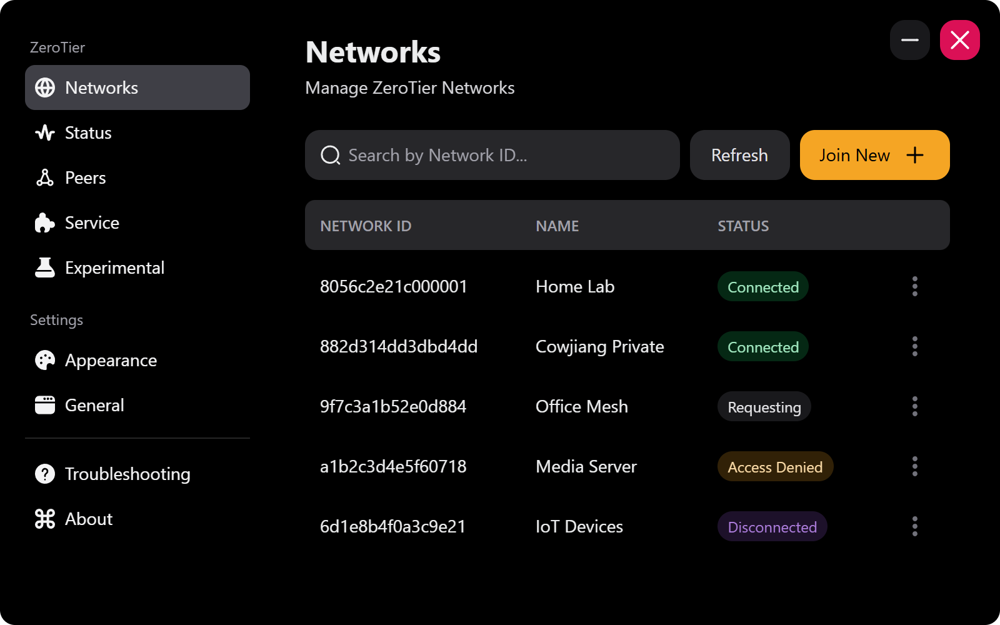
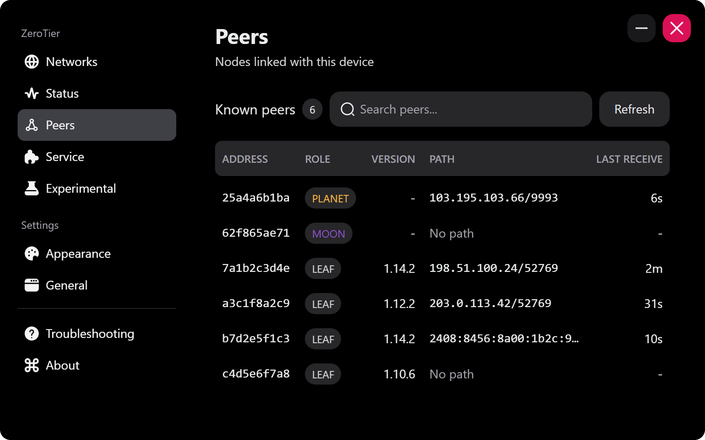
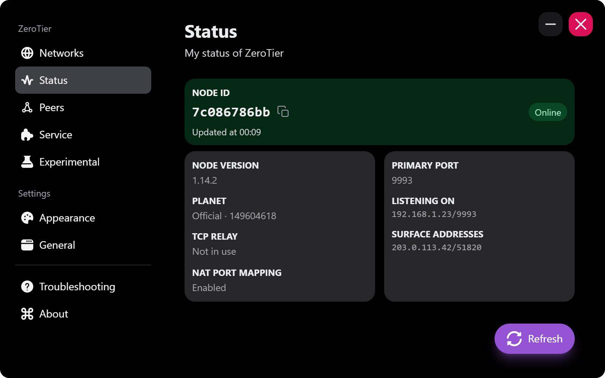
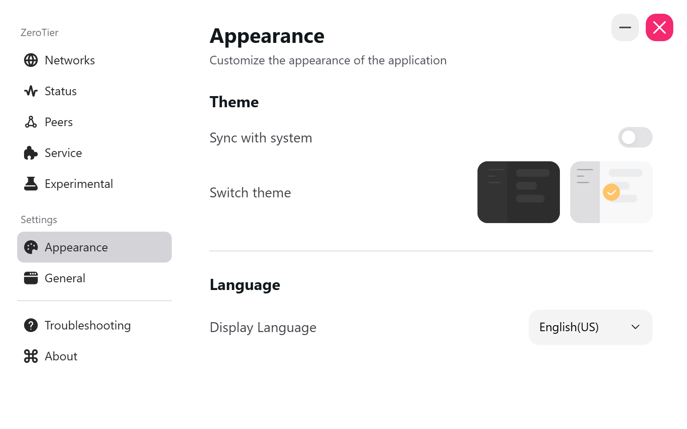

  

# ZeroTier Toolkit

 

    
    

 

English | <a href="./README_CN.md">简体中文</a>

 

ZeroTier Toolkit is an enhanced cross-platform [ZeroTier](https://zerotier.com) GUI for Windows, macOS, and Linux. It
works alongside the official [ZeroTier Desktop UI](https://github.com/zerotier/DesktopUI) and adds network, node, and
peer details, plus Windows service control.

    
    &nbsp;&nbsp;
    
     
     
    
    &nbsp;&nbsp;
    

 

## Download

Builds for Windows, macOS, and Linux are on the
[Releases](https://github.com/Cowjiang/zerotier-toolkit/releases) page. ZeroTier One must be installed and running.

## Planned

- Android client

## Q&A

### 1. How do I use a custom planet or moon?

1. Open Experimental → ZeroTier One Directory, then click Open Folder.
2. Back up the existing `planet` file or `moons.d` directory, then replace it.
3. Restart the ZeroTier service or process.

### 2. macOS says the app is damaged or can't be verified

If you see one of these errors:
- Cannot Be Opened Because the Developer Cannot be Verified
- ZeroTier Toolkit is damaged and can't be opened

Run this command in the terminal:
`sudo xattr -r -d com.apple.quarantine /Applications/ZeroTier\ Toolkit.app`

### 3. macOS can't find my ZeroTier One installation

If ZeroTier One is installed in the default location, give the current user access to its data directory:

`sudo chown -R $USER ~/Library/Application\ Support/ZeroTier`

### 4. How do I restart ZeroTier on macOS or Linux?

1. macOS: `cat /Library/Application\ Support/ZeroTier/One/zerotier-one.pid | sudo xargs kill`
2. Linux: `service zerotier-one restart`

## Copyright

- Logo from `ZeroTier, Inc.`, icons from [FLATICON](https://www.flaticon.com/)
- Built with Tauri, React, and HeroUI

## Contributing

Bug reports and pull requests are welcome. For larger changes, please
[open an issue](https://github.com/Cowjiang/zerotier-toolkit/issues) first.

## License

[MIT](https://github.com/Cowjiang/zerotier-toolkit/blob/main/LICENSE)
