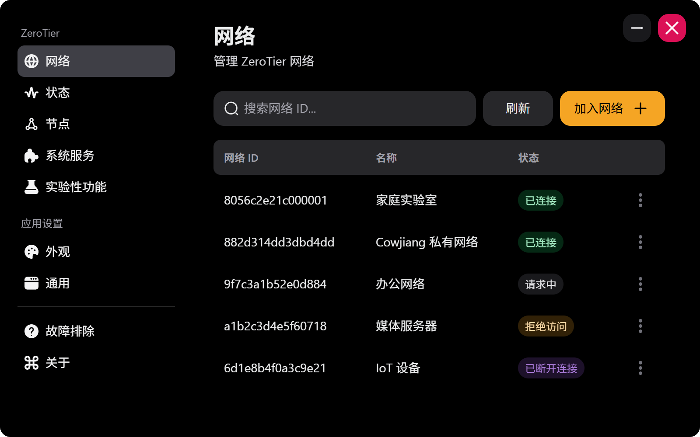
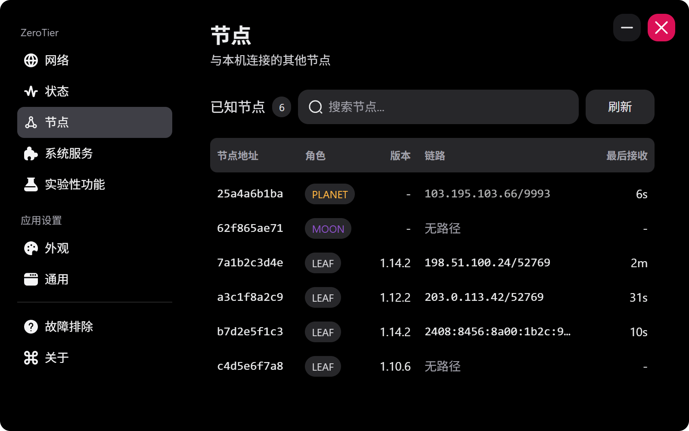
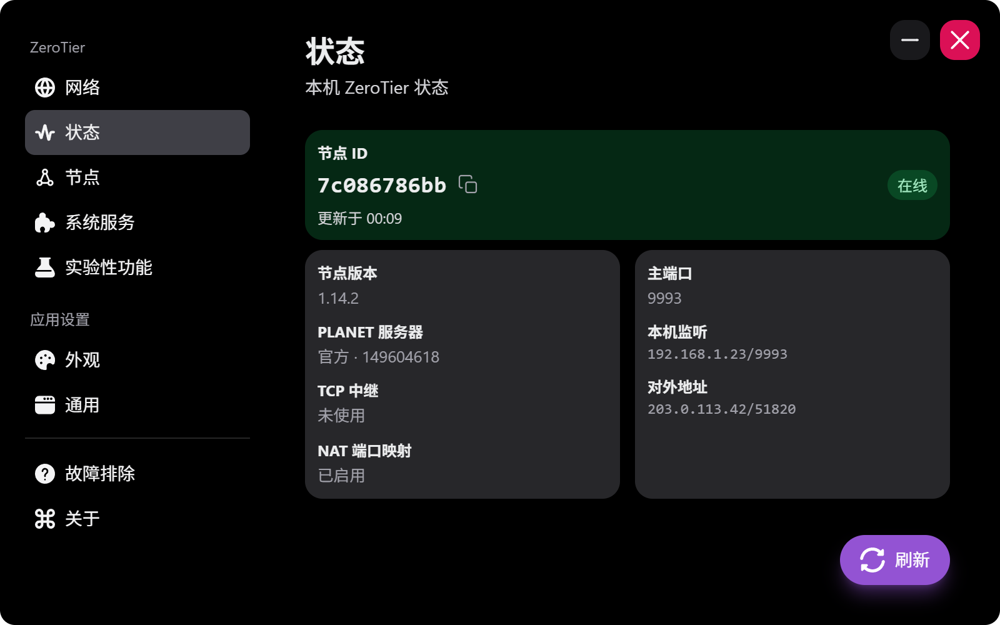
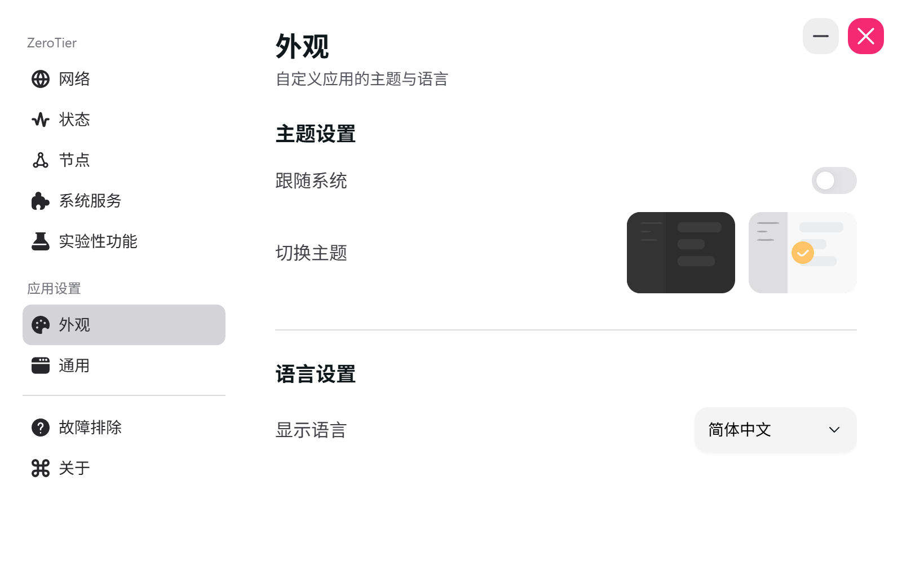

  

# ZeroTier Toolkit

 

    
    

 

<a href="./README.md">English</a> | 简体中文

 

ZeroTier Toolkit 是一个增强版的跨平台 [ZeroTier](https://zerotier.com) 图形客户端，支持 Windows、macOS 和 Linux。它可以和官方 [ZeroTier Desktop UI](https://github.com/zerotier/DesktopUI) 配合使用，补充网络、节点和 Peer 详情，以及 Windows 服务管理。

    
    &nbsp;&nbsp;
    
     
     
    
    &nbsp;&nbsp;
    

 

## 下载

Windows、macOS 和 Linux 的安装包可在 [Releases](https://github.com/Cowjiang/zerotier-toolkit/releases) 页面下载。使用前需要安装并启动 ZeroTier One。

## 计划

- Android 客户端

## 常见问题

### 1. 如何使用自定义 planet 或 moon？

1. 进入「实验性功能」→「ZeroTier One 目录」，点击「打开目录」。
2. 备份原有的 `planet` 文件或 `moons.d` 目录，然后替换。
3. 重启 ZeroTier 服务或进程。

### 2. macOS 提示应用已损坏或无法验证

如果遇到以下错误：
- Cannot Be Opened Because the Developer Cannot be Verified
- ZeroTier Toolkit is damaged and can't be opened

在终端执行：
`sudo xattr -r -d com.apple.quarantine /Applications/ZeroTier\ Toolkit.app`

### 3. macOS 上找不到已安装的 ZeroTier One

如果 ZeroTier One 安装在默认位置，需要让当前用户有权限访问它的数据目录：

`sudo chown -R $USER ~/Library/Application\ Support/ZeroTier`

### 4. 如何在 macOS 和 Linux 上重启 ZeroTier？

1. macOS：`cat /Library/Application\ Support/ZeroTier/One/zerotier-one.pid | sudo xargs kill`
2. Linux：`service zerotier-one restart`

## 版权

- Logo 来自 `ZeroTier, Inc.`，图标来自 [FLATICON](https://www.flaticon.com/)
- 使用 Tauri、React 和 HeroUI 构建

## 贡献

欢迎提交 bug 反馈和 PR。较大的改动请先开 [issue](https://github.com/Cowjiang/zerotier-toolkit/issues) 讨论。

## 许可证

基于 [MIT](https://github.com/Cowjiang/zerotier-toolkit/blob/main/LICENSE) 许可证开源。
